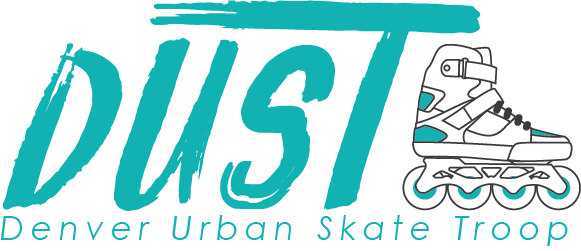

# Denver Urban Skate Troop (*DUST*)

This is a website about an inline & roller skating community in Denver, CO. Users can see upcoming events, subscribe to the DUST Google Calendar, learn about our history and community guidelines, access community resources, connect with us through various social media, and access our online merch shop.

## Future Features 
- A `Community Resources` page with links to various subsets of DUST, local skate shops, lists of popular skate spots, tutorials and skill-learning materials, and more. 
- Faces of DUST: a collection of DUST skater profiles, as featured on our social media.

## Stack
- React JS
- React Router
- Tailwind CSS
- Vite
- Netlify

## Contributions
Contributions to this project are welcomed and encouraged. Please clone this repo, create a new branch (format: `mmddyy-branch-name`), and make a detailed Pull Request outlining the proposed changes.

## Install
* Requires Node 22 (or 20.19+).
* Clone this repo with `git clone git@github.com:Abdeboskey/dust.git dust`.
* `cd dust` and run `npm install`.
* Run `npm install netlify-cli -g` to install the Netlify CLI
* Run `netlify dev` to start the development server. The calendar function needs the `CAL_API` and `CAL_ID` environment variables from Netlify.
* `npm run dev` starts just the site (no calendar), `npm test` runs the tests, and `npm run build` creates a production build in `build/`.
* Keep images small: resize photos and route maps to at most ~2000px wide (route maps ~1200px) before adding them to `src/assets`.

### Happy Skating!

